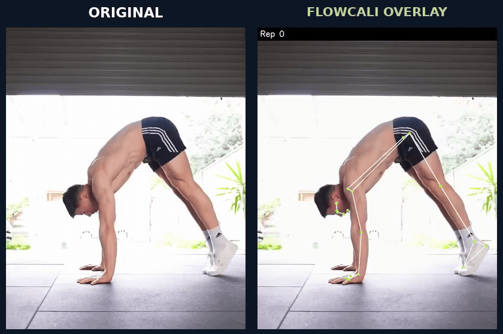
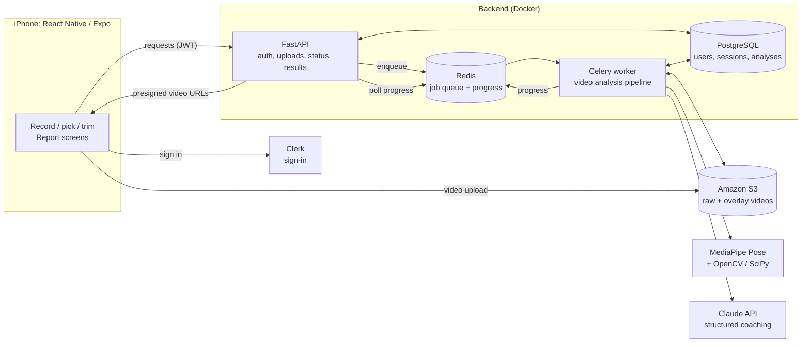
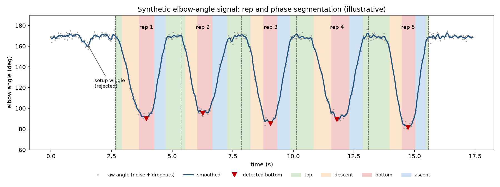

# FlowCali

**Form feedback for calisthenics from a single phone video.**

FlowCali is a mobile app I built that analyzes a recorded set of bodyweight
exercises. It tracks the body with pose estimation, finds each repetition and
the phases within it, measures joint angles and body positions, and returns a
report with per-rep scores, specific form faults, and plain-language coaching,
along with a replay of the video annotated with a skeleton and joint angles.

Most people training calisthenics alone have no one to tell them whether their
hips are stacked or their elbows drift. FlowCali makes those judgments
measurable from a side-on recording. The pike push-up is the movement I
calibrated it on.

<p align="center">
  
  <br>
  <sub>Left: original recording. Right: FlowCali's processed overlay (skeleton, rep and phase label, phase-colored joint angles).
  Full clips: <a href="media/pike-original.mp4">original</a> · <a href="media/pike-overlay.mp4">overlay</a></sub>
</p>

The side-by-side pose comparison and mobile walkthrough feature different source clips.

### App Walkthrough

The recording demonstrates the FlowCali iPhone app selecting a video from the camera roll, submitting it for analysis, and displaying the generated form feedback report.

https://github.com/user-attachments/assets/3af3ad48-7604-4c36-b1a4-6c6542a44bb2

*The processing segment is shortened for the demo. The original analysis took approximately one minute using my local development backend.*

> This repository is a portfolio showcase. The application source is private;
> what's here is documentation, an [engineering write-up](docs/engineering.md),
> and a [standalone signal-processing demo](demo/) you can run.

---

## What it does

Run on my iPhone against the backend on my development machine:

- **Pick or record a set.** Choose a video from the camera roll or record one in
  the app, trim it to the set, and confirm.
- **Background analysis with live progress.** The app uploads the video and
  shows progress through each stage while a worker processes it.
- **Pose tracking and rep detection.** Every sampled frame goes through
  MediaPipe's 33-landmark pose model; reps and movement phases are found from
  joint-angle signals.
- **Form checks and scoring.** Pike push-up checks such as hip position over
  the hands at the bottom, head depth, elbow stacking, lockout, leg and toe
  position, each measured relative to the athlete's own body proportions. Each
  rep gets a score and a list of faults.
- **Coaching report.** A summary, what went well, what to fix and why,
  suggested exercises, and a next-session focus, written by Claude from the
  measured results.
- **Skeleton-overlay replay.** A rendered video with the tracked skeleton, rep
  and phase label, and joint angles colored by whether they're appropriate for
  that phase, played back inside the report.

## Architecture



The app never waits on a long request. The API queues a job and returns at
once, the worker does the heavy processing, and the app polls for progress and
then fetches the stored result. Videos live in S3 and reach the phone through
short-lived presigned URLs. More detail is in
[docs/engineering.md](docs/engineering.md#4-background-processing-and-storage).

## The analysis pipeline

```
video ─▶ upright frames ─▶ pose landmarks ─▶ smoothing ─▶ joint-angle signal
      ─▶ reps ─▶ phases ─▶ form checks + scores ─▶ ┬─▶ coaching report (LLM)
                                                   └─▶ overlay video
```

1. **Decode upright frames.** Phone videos carry a rotation flag that OpenCV
   ignores by default; FlowCali applies it before anything else (see the
   [rotation bug](docs/engineering.md#1-phone-videos-were-being-analyzed-upside-down)).
   High-frame-rate clips are sampled down to about 30 fps and large frames are
   scaled down (long edge ≤ 1280 px) before inference.
2. **Extract pose.** MediaPipe Pose (heavy model) returns 33 landmarks with
   visibility scores per frame. This is a pretrained model; FlowCali doesn't
   train its own.
3. **Smooth.** Short tracking dropouts are interpolated and a Savitzky-Golay
   filter removes jitter; long gaps stay marked as missing.
4. **Angle signal.** Joint angles come from landmark geometry, using whichever
   side of the body is better tracked (from the side, the far arm is often
   hidden).
5. **Reps and phases.** Rep bottoms are valleys in the elbow-angle signal
   (`scipy.signal.find_peaks`); a state machine labels each rep's top, descent,
   bottom and ascent.
6. **Measure and score.** Each check runs in the phase where it's meaningful,
   and distances are normalized to torso length so they hold across body sizes
   and camera distances. Faults have severities, and deductions scale with how
   far a measurement misses.
7. **Report and overlay, in parallel.** The structured results go to Claude for
   the written coaching while the overlay video is rendered (OpenCV, then
   ffmpeg to H.264 for iOS playback).

The movement is chosen by the user. FlowCali doesn't try to recognize which
exercise is being performed.

## Technical highlights

- **Found a data bug that looked like a tuning problem.** Unexpected analyzer
  results on new phone footage were traced to rotation metadata: MediaPipe had
  been analyzing upside-down frames. → [write-up](docs/engineering.md#1-phone-videos-were-being-analyzed-upside-down)
- **Separated slow inference from fast iteration.** Pose landmarks are dumped
  once per clip, so analysis rules could be re-run in seconds during
  calibration, and labeled clips are frozen as regression fixtures.
  → [write-up](docs/engineering.md#2-offline-diagnostics-and-regression-tests)
- **Measured a body from the side.** Torso-length normalization, facing-direction
  detection with a mirror-invariance test, and visibility gating for poorly
  tracked joints. Several checks were removed after they flagged good reps.
  → [write-up](docs/engineering.md#measuring-a-side-on-body)
- **Designed around real upload constraints.** Uploading through the API breaks
  once short-lived auth tokens meet slow mobile uploads, so the later version
  uploads directly to S3 with server-derived keys and an idempotent start step.
  → [write-up](docs/engineering.md#4-background-processing-and-storage)
- **Kept the LLM out of the scoring.** Scores and faults are deterministic; the
  model only explains them, through a fixed schema with a deterministic
  fallback if the call fails.
  → [write-up](docs/engineering.md#5-algorithmic-scoring-vs-llm-written-coaching)

## Try the signal-processing demo

[`demo/`](demo/) is a small, runnable version of the rep- and phase-segmentation
approach on synthetic data, with tests. It uses only NumPy, SciPy and
Matplotlib and has no FlowCali scoring logic.



```sh
cd demo && pip install -r requirements.txt && python run_demo.py && python -m pytest tests -q
```

## Technologies

| Area | Used |
|---|---|
| Mobile | React Native (Expo SDK 51), TypeScript, expo-router, TanStack Query, Zustand, react-native-vision-camera, expo-av, react-native-svg, victory-native |
| API | Python, FastAPI, SQLAlchemy (async), Alembic, Pydantic, slowapi rate limiting |
| Processing | Celery, Redis |
| Computer vision | MediaPipe Pose, OpenCV, NumPy, SciPy, ffmpeg |
| Data & storage | PostgreSQL, Amazon S3 (presigned URLs) |
| AI coaching | Anthropic Claude API (structured outputs) |
| Auth & billing | Clerk (JWT verified via JWKS), RevenueCat |
| Infrastructure & testing | Docker / Docker Compose, Railway, pytest |

## Testing

The private backend has a pytest suite covering joint-angle math, rep
counting, the pike push-up checks on synthetic poses (including a
mirrored-direction test), API behavior and rate limiting, plus a **regression
suite of 9 labeled pike push-up clips**. It freezes each clip's landmarks and the
expected per-rep scores and faults so later changes can't silently rescore
them. The mobile app is type-checked; it has no automated UI tests.

The labels are my own judgments, so the regression suite shows consistency,
not accuracy. **No rep-count accuracy, precision, or scoring-accuracy figures
have been measured**, and the processing interval shown in the walkthrough is one observed run,
not a benchmark.

The [demo](demo/) has its own tests, which run against synthetic ground truth.

## Status and limitations

**Demonstrated**
- The full iPhone workflow (pick video → analysis → report → overlay replay)
  against the backend running locally in Docker.
- Pike push-up analysis calibrated against footage I recorded and labeled
  rep by rep, including deliberate-fault clips.
- Generated coaching reports and skeleton-overlay videos.

**Implemented, not yet demonstrated end to end on the phone**
- The newer direct-to-S3 upload flow (API-tested; the recorded demo used the
  earlier upload path).
- The hosted backend (API and worker are deployed and respond, but a full
  analysis from the phone through the hosted stack hasn't been completed).
- Analyzers for handstand push-ups, planche, front lever, handstand and L-sit.
  These were written from biomechanical criteria but **have never been tested
  on real footage**.

**Known limitations**
- One side-on camera and 2D landmarks: anything that needs depth (for example
  elbow flare) can't be judged reliably, and accuracy depends on lighting,
  clothing contrast and the full body staying in frame.
- Some pike checks have only been seen on the "pass" side; their thresholds
  are provisional. A small setup motion can occasionally be counted as a rep.
- Analysis runs on a server after upload, not in real time or on the device.
- In-app subscriptions are wired up but not functional yet. This is an
  in-progress personal project, not a released product.

## How it was built

I developed FlowCali with **[Claude Code](https://claude.com/claude-code)** as
an AI pair programmer, and much of the implementation was written with its
assistance. My part was the product direction and design choices; the
biomechanics criteria the pike checks are based on; recording and labeling the
calibration footage rep by rep; reviewing the analyzer's output against the
video and deciding which rules to change, add, or remove; testing on my iPhone;
and the integration and deployment decisions (auth, storage, hosting,
billing). The engineering write-up describes the problems as they were worked
through.

Built on: [MediaPipe](https://github.com/google-ai-edge/mediapipe) Pose
(Apache 2.0), [OpenCV](https://opencv.org/), [NumPy](https://numpy.org/),
[SciPy](https://scipy.org/), [FFmpeg](https://ffmpeg.org/),
[FastAPI](https://fastapi.tiangolo.com/), [Celery](https://docs.celeryq.dev/),
[Expo](https://expo.dev/) / React Native, and the
[Anthropic Claude API](https://docs.anthropic.com/) for coaching text, with
Clerk, RevenueCat, AWS S3 and Railway as services. Not affiliated with any of
them.

FlowCali gives automated form feedback, not medical or professional coaching
advice.
