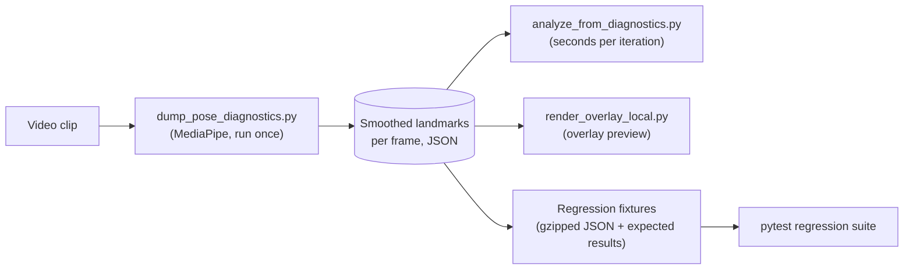
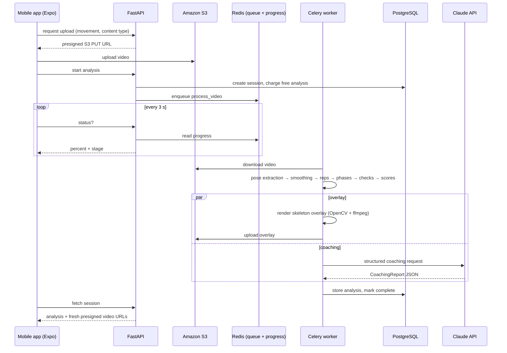

# FlowCali — engineering notes

Five problems from building FlowCali that were more interesting than they first
looked. File paths refer to the private application repository; the source is
not published here.

---

## 1. Phone videos were being analyzed upside down

**Symptom.** After recording a new set of pike push-up clips on my phone, the
analyzer started disagreeing with what I could see. Reps I knew were deep were
flagged as shallow, and the elbow-drift check reported the elbow moving in the
opposite direction from reality. The thresholds looked wrong, and the obvious
move would have been to re-tune them.

**Cause.** Phones often don't rotate the pixels they record. They store an
upright frame plus a rotation flag in the file's metadata, and video players
apply it on playback. OpenCV's `VideoCapture` ignores that flag by default. The
new clips carried a 180° flag, so MediaPipe was given upside-down frames. It
still found a person (pose models are fairly rotation-tolerant), but every
vertical relationship was inverted ("nose below the hands" became "nose above
the hands") and the horizontal direction flipped with it. The rendered overlay
video came out upside down too, which is how the bug was finally spotted.

**Fix.** Enable `CAP_PROP_ORIENTATION_AUTO` so decoded frames come back upright,
and take the frame width and height from the first *decoded* frame rather than
from the container properties, which report pre-rotation dimensions. The
overlay renderer applies exactly the same handling, so the skeleton is drawn on
the same upright frames the landmarks came from
(`backend/app/core/pose/extractor.py`, `backend/app/tasks/video_processor.py`).

**Why it mattered.** The bug looked like a calibration problem, and tuning
thresholds against corrupted data would have made the analyzer worse for every
correctly oriented video. Clips with 90°, 180° and 270° flags all go through
the same path now.

---

## 2. Offline diagnostics and regression tests

Running MediaPipe's heavy pose model on a clip takes far longer than the
analysis logic on top of it. Calibrating the pike push-up checks meant many
rounds of "change a rule, re-run, compare with what I saw in the video," so
re-running pose inference every time was too slow.

The fix was to split the pipeline at the landmarks:

- `scripts/dump_pose_diagnostics.py` runs extraction and smoothing once per
  video and saves every frame's landmarks.
- `scripts/analyze_from_diagnostics.py` re-runs rep detection, phase detection
  and all checks on the saved landmarks in seconds.
- `scripts/render_overlay_local.py` renders a rep-numbered overlay locally so
  rule changes can be checked visually without using the paid pipeline.

Each calibration cycle went the same way. I recorded clips that each isolated
one fault, wrote down per-rep judgments, compared the analyzer's output, and
decided which rule to adjust, add or remove. Several checks were **removed**
because they kept flagging reps I knew were good. For example, a raw
hip-joint-angle "not piked enough" check opened up on a taller athlete without
the pike actually being worse.

Once the pike analyzer agreed with my judgments, I froze the landmark dumps of
the labeled clips as gzipped fixtures, together with their expected rep counts,
rep scores and violation sets (`tests/test_pike_regression.py`,
`scripts/gen_regression_fixtures.py`). Any later change that rescored one of
those clips fails the test, and the expected results can only be regenerated on
purpose.

**What this does and does not show.** The suite guarantees *consistency* with
labels I produced for a small set of clips. It is not an accuracy benchmark:
there is no independent ground truth, no inter-rater agreement and no held-out
dataset large enough to quote precision or rep-count accuracy, and I don't
claim any.

---

## 3. Rep segmentation and phase detection

Rep counting doesn't use a learned model. It is signal processing on one joint
angle per frame (for pike push-ups, the elbow angle).

1. **Smoothing** (`core/analysis/temporal_smoother.py`). Every landmark
   coordinate is a time series. Short tracking dropouts are linearly
   interpolated, a Savitzky-Golay filter removes per-frame jitter while keeping
   the shape of fast movements, and gaps longer than about a third of a second
   are put back to "missing" rather than invented.
2. **Primary angle** (`core/pose/angles.py`). The angle at a joint is computed
   with `atan2` (stable at 0° and 180°, unlike `arccos`) from whichever side of
   the body MediaPipe tracks better. From a side-on camera the far arm is
   usually hidden.
3. **Reps** (`core/analysis/rep_counter.py`). The bottom of each rep is a valley
   in the angle signal, found with `scipy.signal.find_peaks` on the negated
   signal with a minimum prominence and spacing. Each rep spans top → bottom →
   top. Interior boundaries sit at the highest point between neighbouring
   bottoms, and the first and last rep snap to the nearest near-lockout frame so
   walk-in and walk-off footage isn't absorbed into them.
4. **Phases** (`core/analysis/phase_detector.py`). A small state machine labels
   each rep's frames *top / descent / bottom / ascent* using bands relative to
   that rep's own angle range, so it still works when depth changes across a
   set.

Phases matter because most form checks only make sense at a particular moment:
lockout at the top, depth and hip position at the bottom.

**A limitation found on real footage.** A setup rock before the first rep was
once counted as a rep. Raising the prominence threshold to reject it also
dropped a genuine shallow rep from a labeled clip: the two overlap in
prominence. Fixing it properly needs a different signal (position or depth),
not a stricter threshold, so it is documented as open rather than hidden by a
tweak.

[`demo/`](../demo/) has a standalone, runnable version of steps 1, 3 and 4 on
synthetic data.

### Measuring a side-on body

Measurements are 2D and normalized to the athlete's **torso length**
(shoulder midpoint to hip midpoint) instead of image pixels or shoulder width.
From the side the shoulders overlap and their apparent width shrinks to almost
zero, while the torso stays visible and scales with body size and camera
distance. Checks that depend on left/right first decide which way the athlete
faces (from shoulders relative to hips), and a mirrored-input test confirms
results don't change with facing direction. Checks that need a reliable elbow
only use frames where MediaPipe's visibility score for it is high, because
poorly tracked elbows produced confident-looking false "incomplete lockout"
flags.

---

## 4. Background processing and storage

Design decisions worth calling out:

- **Video processing is a background job.** Pose extraction is CPU-heavy and
  takes tens of seconds, so the API only queues work and reports progress. The
  app polls a status endpoint backed by a short-lived Redis key.
- **Two database engines.** FastAPI uses async SQLAlchemy (asyncpg); the Celery
  worker uses a synchronous engine, because asyncpg can't run inside a Celery
  worker process.
- **Direct-to-S3 upload.** The first version posted the video to the API as
  multipart form data. That worked on home Wi-Fi, but once the API was hosted
  it would fail: auth session tokens are short-lived, and the API only checks
  the token once the whole request body has arrived, so any upload slower than
  the token's lifetime gets a 401. The fix was to split the flow into three
  steps: get a presigned PUT, upload straight to S3, then confirm. The S3 key is
  derived on the server from the authenticated user and session (a client can't
  name someone else's object), the confirm step is idempotent so a retry can't
  double-charge, and a clip rejected later by the worker gets its free analysis
  refunded (`api/routes/analyze.py`, `utils/storage.py`). This flow is
  implemented and covered by API tests but hasn't yet been demonstrated end to
  end on a phone. The recorded demo used the earlier upload path against the
  local backend.
- **Overlay and coaching run concurrently.** Rendering is CPU and ffmpeg work;
  the LLM call is network wait. Running them in parallel inside the job overlaps
  the two. The overlay is best-effort: if it fails, the analysis is still saved.
- **The overlay is H.264.** OpenCV writes MPEG-4 Part 2 (`mp4v`), which iOS
  won't play, so the overlay is re-encoded with ffmpeg.
- **Videos stay private.** S3 holds object keys only; the API mints one-hour
  presigned URLs per request and never stores them.

---

## 5. Algorithmic scoring vs. LLM-written coaching

The language model never decides whether a rep was good. The split is strict:

| Produced deterministically (pose geometry + rules) | Written by Claude from those results |
|---|---|
| Rep count, rep boundaries, phases | Session summary |
| Per-rep measurements (angles, torso-normalized distances) | "What you did well" |
| Which form faults occurred, and their severity | Plain-language *what / why / how to fix* for each fault |
| Rep scores and set score | Suggested exercises and cues |
| Technique-vs-fatigue tag per fault, fatigue trend data | Progression readiness, next-session focus |
| Skeleton overlay video | |

The worker sends Claude the structured analysis and asks for a fixed
Pydantic schema (`CoachingReport`) using the Anthropic SDK's structured-output
parsing (`core/coaching/llm_client.py`, `schemas.py`). The prompt tells the
model to translate measurements into plain language rather than quoting raw
ratios.

If the call fails for any reason, a deterministic report built only from the
measured data is used instead (`core/coaching/response_parser.py`), so an
analysis never fails because of the LLM. That fallback hid a real bug for a
while: the output-token limit was too small for multi-rep reports, the JSON got
truncated, and every such report silently fell back to the template. Raising
the limit fixed it. The lesson is to monitor how often a fallback runs, not just
whether one exists.

In the app, the score, rep cards and overlay come from the deterministic
analysis; the explanatory text comes from the model.
